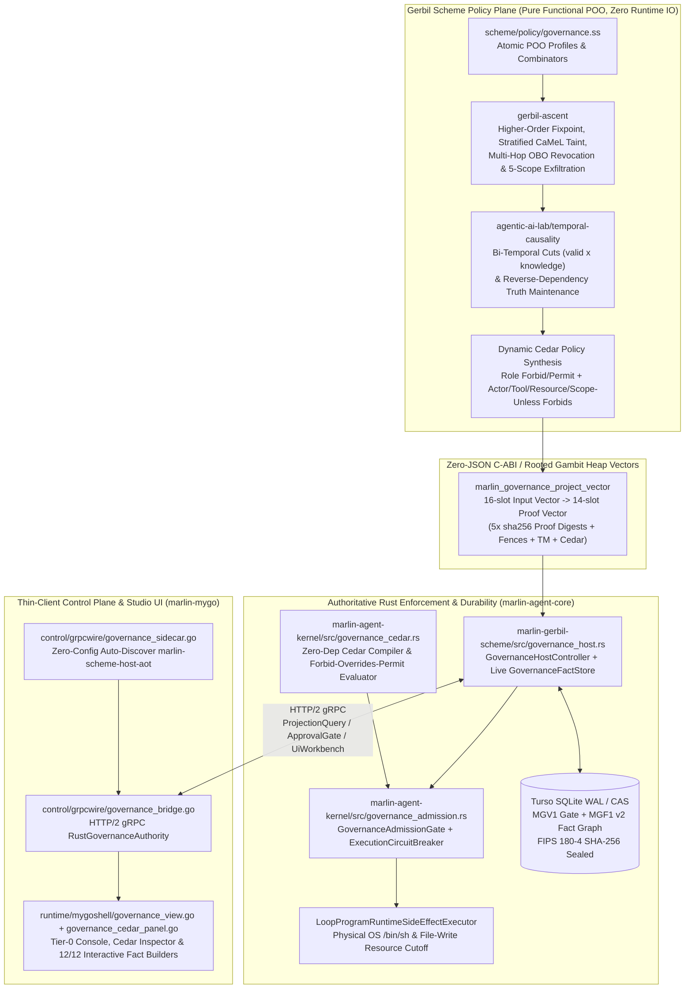

<!--
SPDX-FileCopyrightText: 2026 tao3k team and Contributors

SPDX-License-Identifier: Apache-2.0 AND LGPL-2.1-or-later
-->

# Marlin Governance Authority Plane Architecture

Marlin's Governance Authority Plane amplifies `agentic-ai-lab`'s pure functional Gerbil Scheme governance substrate (**Atomic POO × `gerbil-ascent` Stratified Datalog & Higher-Order Fixpoints × Bi-Temporal Causality & Truth Maintenance × One-Shot `AuthorizedEffectToken` Strict Mediation × Dynamic Cedar Policy Synthesis**) and binds it across a zero-JSON rooted Gambit heap boundary into Rust's authoritative execution kernel (`marlin-agent-kernel`), tamper-evident Turso SQLite WAL checkpoints (`MGV1` + `MGF1` v2), standalone zero-`.ss` Linked-AOT daemon (`marlin-scheme-host-aot`), and `marlin-mygo`'s Tier-0 Governance Console UI.

---

## 1. End-to-End Architecture



---

## 2. Core Security Invariants

1. **Assessment Is Never Authority**: Scheme emits pure functional proof envelopes (`runtime-executed?: #f`) with 5 canonical `sha256:` digests (`assessment`, `taint`, `fixpoint`, `temporal`, `invalidation`). Only Rust's `GovernanceAdmissionGate` and `ExecutionCircuitBreaker` execute physical OS side effects.
2. **Zero JSON on Internal Scheme↔Rust Boundary**: All runtime requests and proof projections cross Gambit FFI via 16-slot input / 14-slot output rooted heap vectors (`scheme/c-abi/graph-engine.ss`, `crates/marlin-gerbil-scheme/src/governance_policy_abi.rs`).
3. **Structured Cedar `forbid`-Overrides-`permit` (Fail-Closed)**:
   - Every synthesized Cedar policy is parsed by `marlin-agent-kernel/src/governance_cedar.rs` (supporting `when`, `unless`, `==`, `!=`, `!context.<k>`, and `Marlin::Scope::"..."` resource groups) before installation; malformed syntax or missing condition keys fail closed (`InvalidCedarPolicy`).
   - Any matching `forbid` overrides every `permit` (including `VerifiedHuman` with `context.step_up_fresh == true`).
   - On un-declassified `private -> external` escalation, Scheme synthesizes BOTH a target-specific resource `forbid` (`Marlin::Resource::"<target>"`) and a defense-in-depth scope guard (`forbid (principal, action, resource in Marlin::Scope::"external") unless { context.declassified == true };`).
   - `LoopProgramRuntimeSideEffectExecutor` routes both process spawns and file writes through `authorize_side_effect_on_resource`, physically blocking resource-scoped exfiltration targets (e.g. `Marlin::Resource::"ext-webhook.txt"`).
4. **One-Shot RFC 9470 Human-Only Step-Up Re-Arm**:
   - `DispatchUiEvent("scheme:governance-rearm ...")` is rejected fail-closed.
   - Re-arming a tripped breaker requires claiming the exact active one-shot `ApprovalGateService` gate (`gov-rearm-epoch-<N>`) with a verified human RFC 9470 ACR attestation (`stepup-verified:actor=<human>:acr=<urn>`). Agent identities are denied and trigger immediate gate rotation.
5. **Anti-Restart-Reset & Tamper Fail-Closed Durability (`MGV1` + `MGF1` v2)**:
   - Both gate state (`MGV1`) and the live runtime fact graph (`MGF1` v2: delegations, revocations, 5-scope context flows, declassifications, CaMeL taint graph, and dynamic Bi-Temporal causal derivations) are sealed with trailing 32-byte FIPS 180-4 SHA-256 tags and flushed to Turso SQLite WAL before publishing gRPC snapshots.
   - On OS restart, persisted state always wins over a cold `clean` boot flag; any single-bit corruption in either `MGV1` or `MGF1` auto-trips the breaker fail-closed (`mode=corrupt_fail_closed`).
6. **Formal Refinement (10 Composed Quint Countermodels)**:
   - `dev/quint/threat/MarlinBackendDurableGovernanceOverlay.qnt` composes `AgentToolCircuitBreaker` with durable `MGV1`/`MGF1` recovery, Cedar `forbid`-overrides-`permit`, and Bi-Temporal retraction.
   - `crates/marlin-agent-kernel/tests/durable_governance_mbt.rs` generates live Quint ITF traces and proves all 10 adversarial countermodels are deterministically refused by real Rust code.

---

## 3. Control-Plane Command Protocol (`DispatchUiEvent`)

| Command | Effect |
| --- | --- |
| `scheme:governance-estop <actor>:<reason>` | Immediate operator E-Stop latch + `MGV1` Turso flush + one-shot re-arm gate |
| `scheme:governance-eval-incident` / `scheme:governance-eval-clean` | Reset fact store to incident or clean baseline and evaluate live Scheme VM |
| `scheme:governance-delegate <parent> <child>` | Record OBO delegation edge in `MGF1` v2 and re-run ASCENT fixpoint |
| `scheme:governance-revoke <actor>` | Revoke principal, compute ASCENT transitive closure, synthesize Cedar `forbid` rules |
| `scheme:governance-context-flow <entry> <src> <target> <dst>` | Record 5-scope flow (`private < direct-message < channel < workspace < external`) |
| `scheme:governance-declassify <entry>` | Explicitly declassify context entry and remove exfiltration Cedar `forbid` |
| `scheme:governance-taint-edge <src> <dst> [source\|sink\|both]` | Record CaMeL taint-flow edge and evaluate stratified Datalog taint paths |
| `scheme:governance-sanitize <node>` | Register verified sanitizer node cutting CaMeL taint paths |
| `scheme:governance-register-derivation <id> <policy> <premises> [parents]` | Register dynamic Bi-Temporal causal derivation node in `MGF1` v2 |
| `scheme:governance-retract <subject>` | Retract Bi-Temporal premise and compute exact reverse-dependency blast radius |
| `scheme:governance-check-cedar <actor> <action> <resource> [true\|false]` | Live compiled-Cedar probe returning `allow` / `deny` / `implicit_deny` + policy IDs |

---

## 4. One-Command Build & Verification

```bash
# 1. In marlin-agent-core: build standalone zero-.ss Linked-AOT binary (`target/debug/marlin-scheme-host-aot`)
just scheme-host-aot-build

# 2. In marlin-agent-core: run full Scheme + Rust Cedar + 10-countermodel Quint MBT + Live VM + AOT gate
just governance-gate

# 3. In .data/marlin-mygo: run all 7 zero-.ss Linked-AOT cross-process E2E suites (incl. GPU UI & restart resilience)
just governance-aot-e2e

# 4. Launch desktop Studio with zero-config auto-discovered Linked-AOT Governance Authority
go run ./cmd/marlin-app
```
